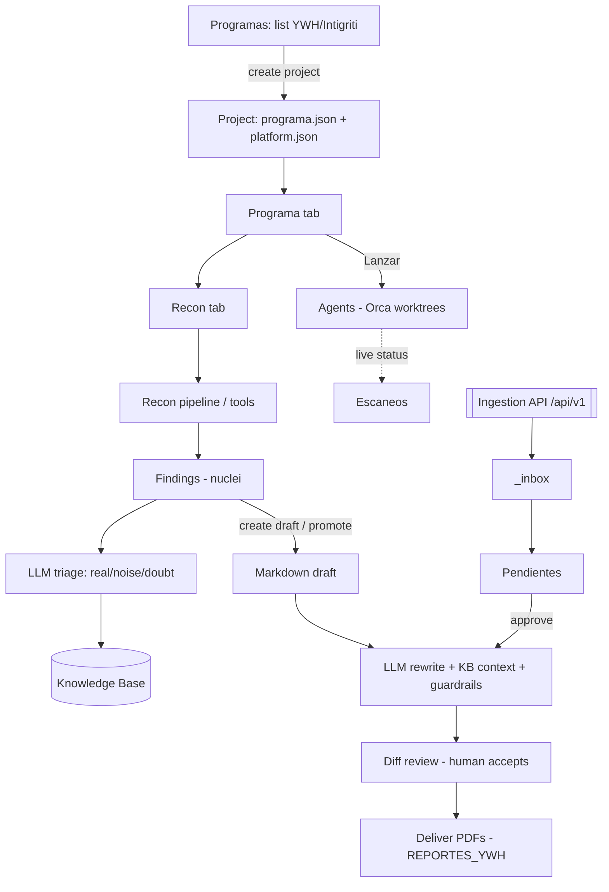
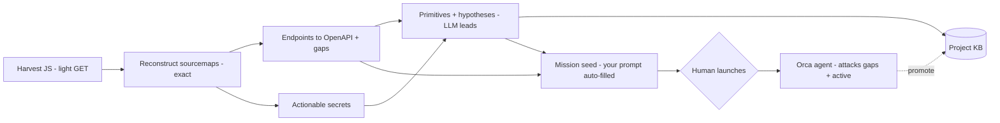
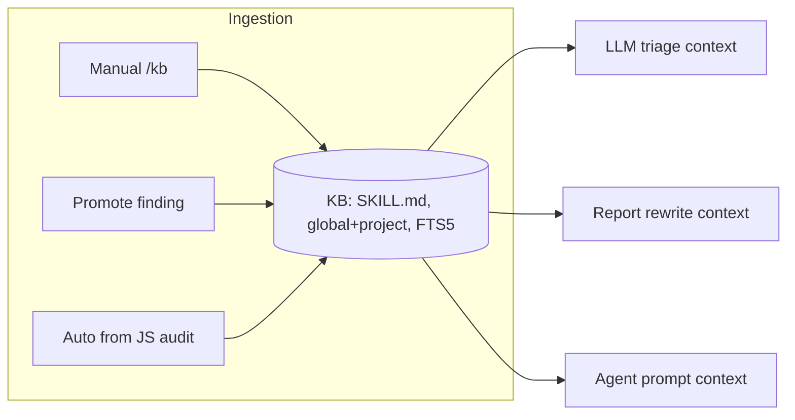

# reporter

Local web app to **run and manage bug-bounty work end to end**: explore programs,
recon the scope with real tools, reconstruct & audit JavaScript, launch AI agents, triage
findings, keep a reusable knowledge base, and write & deliver reports.

**Core principle:** the **filesystem is the source of truth**; everything else (the SQLite
index, the FTS index, caches) is a *view* that can be rebuilt from disk at any time.

**Safety-first by design** (authorized bug bounty only):
- **Nothing runs without a human.** Active/exploitation tooling and anything that arrived
  from outside pass an explicit gate; automation never crosses that line on its own.
- **Whitelist, no shell.** Recon tools are a fixed catalog with fixed recipes, spawned with
  `shell:false` and argument arrays — no command injection, no free-form args.
- **Scope-bounded.** Targets are intersected server-side against the program's `programa.json`.
- **Untrusted target data.** Anything coming from the target (HTTP responses, JS) is treated
  as DATA, never instructions: every LLM call escapes delimiters + a per-call nonce.
- **Local only.** The server binds `127.0.0.1`; tokens/keys are AES-256-GCM encrypted and
  never versioned.

---

## Startup

```bash
pnpm install
pnpm dev        # http://127.0.0.1:3100 (localhost only)
```

Requires Node 22 + pnpm. Configuration lives in `.env.local`:

| Variable | Meaning |
|---|---|
| `REPORTS_ROOT` | Root folder holding the projects (`<project>/REPORTES_YWH/*.pdf` + `<project>/reportes/*.md`) |
| `API_TOKEN` | `Bearer` token for the ingestion API (generate with `openssl rand -hex 32`) |

If `REPORTS_ROOT` is missing or invalid, the app **refuses to start** (fails at boot with a
clear message). Tests: `pnpm test` (Vitest). The SQLite index is rebuildable: `pnpm run db:reset`.

---

## The pages

| Route | What it is |
|---|---|
| `/` Proyectos | Project explorer: counters, delivered PDFs (viewer + drag-drop upload), markdown drafts |
| `/proyectos/[project]` | Per-project tabs: **Programa · Entregados · Borradores · Escaneos · Recon** |
| `/programas` | Multi-platform explorer (YesWeHack · Intigriti) over a neutral model |
| `/escaneos` | Live status of launched agents (Orca) + recon actions |
| `/recon` (tab) | Recon pipeline, single tools, diffing, findings + LLM triage, JS audit, mission seed |
| `/novedades` | Continuous-monitoring news (new assets between scheduled passive runs) |
| `/correlacion` | Cross-project read-only view: findings by severity, repeated patterns |
| `/kb` Conocimiento | Knowledge base (Agent-Skills `SKILL.md` style), 2 scopes, FTS5, tag/category facets |
| `/reportes` | YesWeHack "my reports" (cached) |
| `/estructura-informe` | Report templates manager |
| `/prompts` | Reusable agent prompts library |
| `/cvss` | CVSS 3.1 calculator (FIRST spec) |
| `/pendientes` | Human-in-the-loop approval queue (SSE badge) |
| `/ajustes` | Settings: LLM provider, platform tokens, recon binary paths, Orca, scheduler |

---

## End-to-end flow (a program, from discovery to report)



Two execution engines run in parallel, both human-launched: **recon tools** (whitelisted) and
**AI agents** (Orca). Everything funnels into drafts → LLM rewrite → delivered reports.

## JS-audit relay (deterministic A → agent B)

The highest-signal recon path. `reporter` does the **reliable, deterministic** reconstruction
and **marks the gaps**; the agent (launched by you) attacks the gaps and the active surface.



Coverage is reported honestly (what was reconstructed vs. the gaps). LLM output is **leads,
never facts**; launching anything active against the target stays a human click.

## Knowledge base — it breathes both ways



Entries are Agent-Skills `SKILL.md` folders (name + description + body + `references/`), in two
scopes (**global** reusable + **project** target-intel, project wins). Discovery is by the
**description index** (progressive disclosure) and lexical **FTS5/BM25** search (no vector DB;
see `docs/kb-retrieval-study.md` for the RAG vs GraphRAG decision).

## Continuous monitoring (passive only)


**Sacred rule:** only passive/light stages auto-run; active/exploitation is never scheduled.

---

## Architecture

```
src/
├── app/        Next routes: pages + server actions + API (ingestion v1, files/raw, events SSE)
├── components/ UI (editor, explorers, panels, wizards)
├── core/       PURE domain, no Next — all unit tests live here
│   ├── fs/         safe paths (anti-traversal), atomic write, tree, watcher, trash/history, uploads
│   ├── reports/    front-matter (lossless), templates, placeholders, review (deterministic diff)
│   ├── llm/        OpenAI-compatible client, prompt (anti-injection), rewrite, settings, pricing
│   ├── recon/      tool catalog + recipes, pipeline, diff, findings, js-recon/endpoints/secrets,
│   │               primitives, mission, schedule, flows
│   ├── kb/         knowledge base (SKILL.md CRUD, index, render, facet)
│   ├── programs/ ywh/ intigriti/   neutral model + per-platform clients/adapters
│   ├── orca/       agent launcher parsing/runner, local git, settings
│   └── cvss/ prompts/
├── server/     live/stateful: watcher-service, recon-runner, recon-scheduler, js-harvest,
│               derive-primitives, scans, launches, recon-diff, rewrite, generate-rewrite
├── db/         SQLite index (drizzle + better-sqlite3): schema, reindex, pending, runs,
│               findings, kb-index (FTS5), recon-news, correlation
└── lib/        env (fail-fast), auth, http, secrets (AES-256-GCM), autosave, paths
```

### Data on disk (never versioned — possible NDA)

```
REPORTS_ROOT/
├── _inbox/                      # reports with no project (ingestion API)
├── .config/{templates,prompts,kb}/   # global config; .config is hidden to the watcher
├── .trash/  .history/           # recoverable deletes & pre-save backups
└── <project>/                   # one dir per program (slug)
    ├── .config/{platform.json,templates,kb}/
    ├── programa.json            # platform program detail (raw, no-lossy)
    ├── pentest/                 # gitignored locally; recon outputs, launches, info.md, js/
    │   ├── recon/<tool>/<date>/ # output.log + run.json  (+ js/: openapi/secrets/coverage)
    │   └── launches.json
    ├── REPORTES_YWH/            # delivered PDFs (read-only in the app)
    └── reportes/                # markdown drafts (what you edit)
```

Rules: `reportes/` isn't versioned (recreated if missing); the SQLite & FTS indexes are
rebuildable; tests use temp dirs and never touch the real data or `.settings/`.

---

## Testing & conventions

- `pnpm test` — Vitest. Core modules are pure and fully tested; UI is covered by types/lint
  plus manual checks. No test touches real data (`tmpdir` + injected `fetch`/`exec`).
- `pnpm lint` (ESLint) · `npx tsc --noEmit` (types).
- Work is tracked in `tasks/` (one file per task, with in-depth tests + a validation checklist).

> This README and `docs/` are kept in English (code comments and `tasks/` are in Spanish).
